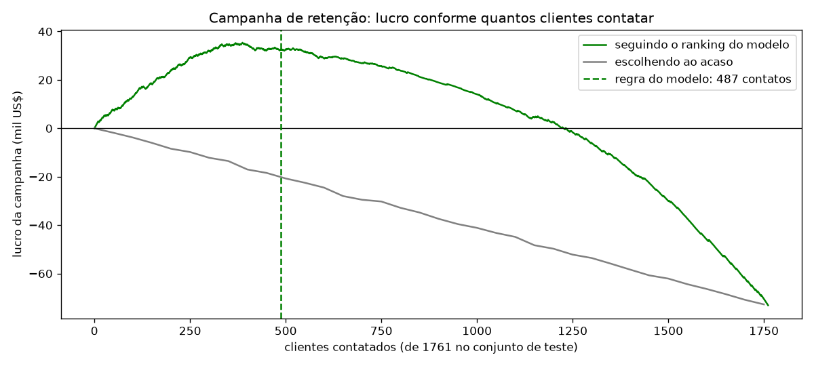
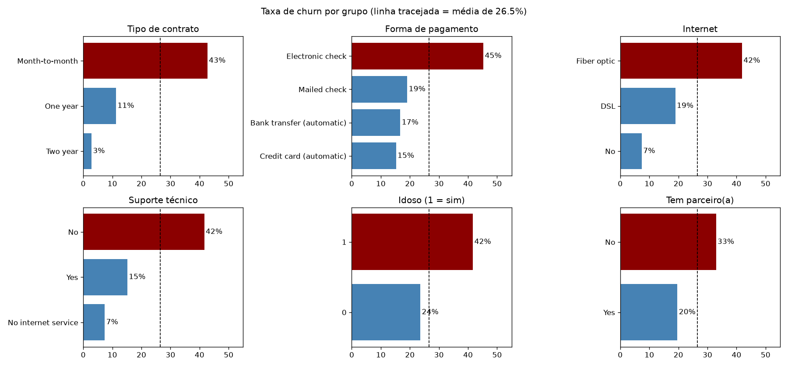
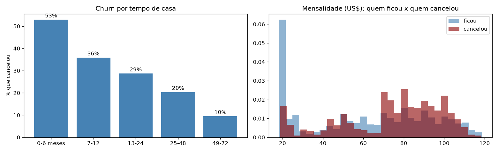
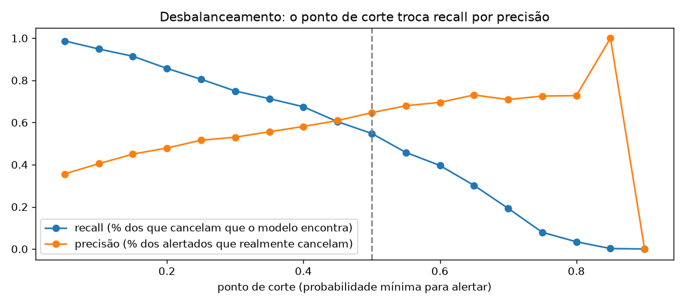
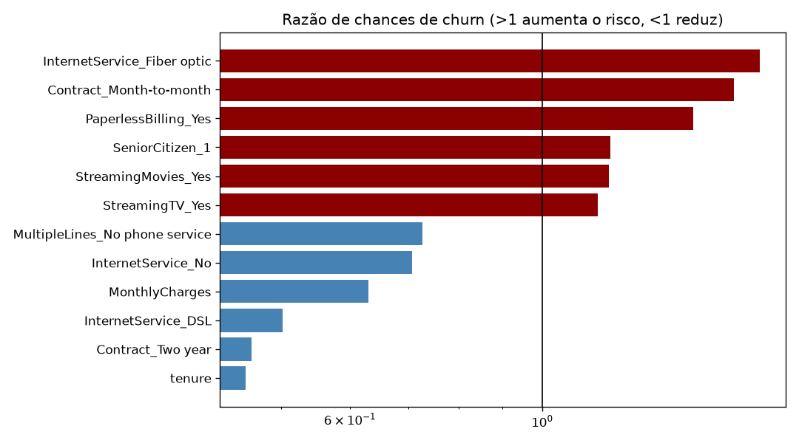

# Previsão de churn em telecom: quem vai cancelar e quanto vale evitar

> **Quais clientes têm maior chance de cancelar e quantos deles vale a pena tentar reter?** Este projeto vai além de "o modelo acerta X%": ele traduz as previsões em uma **campanha de retenção com lucro calculado**, mostrando quantos e quais clientes contatar para ganhar o máximo.



## Resumo

- **26,5% dos clientes cancelaram**, e eles representavam **30,5% da receita mensal**: quem cancela paga mais (US$ 74 x US$ 61 por mês).
- **Perfil de maior risco:** cliente novo, com contrato mensal, internet por fibra óptica, sem suporte técnico e pagando com boleto eletrônico.
- **Contatar todos os clientes com uma oferta de desconto dá prejuízo** (-US$ 73 mil no conjunto de teste), porque quem não ia cancelar também recebe o desconto.
- **Seguindo o modelo**, a campanha contata 487 dos 1.761 clientes de teste e dá **lucro de US$ 33 mil** (cerca de US$ 130 mil se aplicada à base inteira), contra -US$ 20 mil escolhendo o mesmo número de clientes ao acaso.
- **Resultado robusto:** mesmo se a oferta convencer só 15% dos clientes, o modelo ainda dá lucro, ajustando sozinho o número de contatos.

---

## 1. Dados

Base pública [Telco Customer Churn](https://github.com/IBM/telco-customer-churn-on-icp4d) da IBM: **7.043 clientes** de uma operadora de telecom, com perfil (gênero, idoso, parceiro, dependentes), tempo de casa, serviços contratados (telefone, internet, segurança, suporte, streaming), contrato, forma de pagamento, mensalidade, total pago e se o cliente cancelou (`Churn`).

**Qualidade dos dados:** não há clientes duplicados. Onze clientes estão com o total pago (`TotalCharges`) em branco; todos têm **0 meses de casa**, ou seja, acabaram de entrar e ainda não pagaram nada, então o valor correto é 0 (e não a média nem a exclusão).

## 2. Quem cancela



| Fator | Maior churn | Menor churn |
|---|---|---|
| Contrato | Mensal: **43%** | 2 anos: **3%** |
| Pagamento | Boleto eletrônico: **45%** | Cartão automático: 15% |
| Internet | Fibra óptica: **42%** | Sem internet: 7% |
| Suporte técnico | Sem suporte: **42%** | Com suporte: 15% |
| Idade | Idosos: **42%** | Demais: 24% |



- **Os primeiros meses são críticos:** 53% dos clientes com até 6 meses de casa cancelam; com mais de 4 anos, só 9,5%.
- Quem cancela tem, em média, **18 meses de casa**, contra 38 de quem fica.
- O alto churn da **fibra óptica**, o serviço mais caro, sugere insatisfação com preço ou qualidade e merece investigação com a área de produto.

## 3. Modelos e dados desbalanceados

Treino com 75% dos clientes e teste com 25%, mantendo a proporção de churn nos dois conjuntos; ROC-AUC também medido com validação cruzada estratificada (5 partes) no treino. `TotalCharges` ficou de fora por ser redundante (≈ tempo de casa × mensalidade).

| Modelo | Acurácia | Recall | Precisão | ROC-AUC | PR-AUC |
|---|---|---|---|---|---|
| Referência: "ninguém cancela" | 73,5% | 0% | — | 0,50 | — |
| **Regressão logística** | 80,1% | 54,8% | 64,6% | **0,845** | 0,634 |
| Logística com peso (`class_weight="balanced"`) | 75,4% | 79,0% | 52,4% | 0,844 | 0,632 |
| Gradient boosting | 79,6% | 49,9% | 64,9% | 0,840 | 0,641 |

*Recall e precisão com ponto de corte de 0,5.*

**Lições sobre desbalanceamento:**

- **Acurácia engana:** dizer que ninguém cancela já acerta 73,5%.
- Dar **peso maior** à classe minoritária aumenta muito o recall (55% → 79%), mas reduz a precisão e **distorce as probabilidades**.
- Os três modelos ordenam os clientes de forma muito parecida (ROC-AUC ≈ 0,84). A escolha foi a **regressão logística**: simples, explicável e com probabilidades realistas, que são a base do cálculo financeiro.
- O ponto de corte de 0,5 é arbitrário: baixar o corte encontra mais clientes que vão cancelar, mas gera mais alarmes falsos. **Neste projeto, o corte é escolhido pelo lucro**, e não por uma métrica estatística.



**O que aumenta o risco (razão de chances, com os demais fatores iguais):** fibra óptica (1,8x), contrato mensal (1,7x) e fatura digital (1,5x) aumentam a chance de cancelar; contrato de 2 anos e mais tempo de casa a reduzem pela metade ou mais.



## 4. Impacto financeiro da retenção

**Premissas da campanha** (em `src/financeiro.py`, fáceis de ajustar):

| Premissa | Valor |
|---|---|
| Custo de cada contato | US$ 10 |
| Oferta para quem é contatado | desconto de 2 mensalidades |
| Receita preservada de um cliente retido | 12 mensalidades |
| Clientes que iam cancelar e aceitam ficar | 30% |
| Clientes que não iam cancelar | aceitam o desconto (custo sem retorno) |

**Regra de decisão:** para cada cliente, o modelo calcula o **lucro esperado** de contatá-lo:

```
probabilidade de churn × 30% × (12 − 2) × mensalidade  −  (1 − probabilidade) × 2 × mensalidade  −  US$ 10
```

Contatam-se os clientes com lucro esperado positivo. Isso considera **ao mesmo tempo o risco e o valor do cliente**: um cliente de risco médio com mensalidade alta pode valer mais a pena que um de risco alto com mensalidade baixa.

**Resultado no conjunto de teste (1.761 clientes, 467 que de fato cancelaram):**

| Estratégia | Clientes contatados | Lucro |
|---|---|---|
| Contatar todos | 1.761 | **-US$ 73 mil** |
| Contatar ao acaso | 487 | -US$ 20 mil |
| **Contatar os indicados pelo modelo** | **487** | **+US$ 33 mil** |

Entre os 487 contatados pelo modelo, 291 iam de fato cancelar (60%, contra 26,5% numa escolha ao acaso).

**Análise de sensibilidade:** a premissa mais incerta é quantos clientes a oferta convence.

| Taxa de retenção | Contatos indicados | Lucro com o modelo | Lucro contatando todos |
|---|---|---|---|
| 15% | 256 | +US$ 6 mil | -US$ 125 mil |
| 30% | 487 | +US$ 33 mil | -US$ 73 mil |
| 45% | 613 | +US$ 68 mil | -US$ 22 mil |

Em todos os cenários o modelo dá lucro, e contatar todos dá prejuízo.

## 5. Recomendações ao negócio

1. **Campanha de retenção dirigida:** contatar só os clientes indicados pelo modelo, priorizando o lucro esperado e não apenas o risco.
2. **Migração de contrato:** oferecer vantagens para trocar o contrato mensal pelo anual, o fator que mais reduz o churn.
3. **Débito automático:** incentivar a troca do boleto eletrônico por débito ou cartão automático.
4. **Primeiros 6 meses:** acompanhamento especial (onboarding, suporte técnico) para clientes novos.
5. **Fibra óptica:** investigar com a área de produto se o problema é preço ou qualidade do serviço.

## 6. Limitações e próximos passos

- As premissas financeiras são ilustrativas; numa empresa real, a taxa de retenção deve ser medida com um **teste A/B** (grupo contatado x grupo de controle).
- A base é uma foto de um único momento; o ideal seria prever o churn dos próximos meses com o histórico de uso e de atendimento de cada cliente.
- Testar a calibração das probabilidades e modelos de **uplift**, que estimam quem muda de ideia por causa da oferta (e não só quem vai cancelar).

## 7. Como reproduzir

Requisitos: Python 3.11 e acesso à internet (para baixar a base do GitHub da IBM).

```bash
python -m venv .venv
.venv\Scripts\activate        # Windows
# source .venv/bin/activate   # Linux/macOS
pip install -r requirements.txt
```

Rode os notebooks na ordem: `notebooks/01_exploracao.ipynb` (download, qualidade e análise de comportamento) e `notebooks/02_modelagem.ipynb` (modelos, desbalanceamento e impacto financeiro).

## 8. Estrutura do projeto

```
previsao-churn-telecom/
├── notebooks/
│   ├── 01_exploracao.ipynb    # download, qualidade dos dados e comportamento de quem cancela
│   └── 02_modelagem.ipynb     # modelos, desbalanceamento, fatores de risco e impacto financeiro
├── src/
│   └── financeiro.py          # premissas e cálculo do lucro da campanha de retenção
├── reports/figures/           # gráficos deste README
├── requirements.txt
└── README.md
```

## 9. Tecnologias

Python · pandas · NumPy · scikit-learn (Pipeline, regressão logística, gradient boosting, validação cruzada) · Matplotlib · Jupyter

## Autor

**Igor Bicalho**, cientista de dados
[LinkedIn](https://www.linkedin.com/in/igorcbicalho)

*Dados: IBM Telco Customer Churn, base pública disponibilizada pela IBM.*
